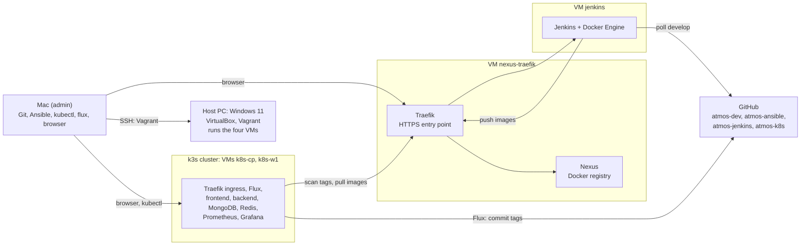
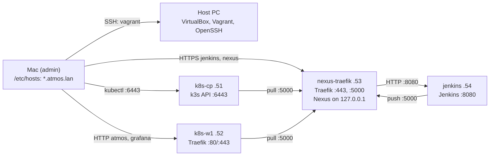

# Atmos: On-Premise Architecture

## 1. Overview

The Atmos application (React, FastAPI, MongoDB, Redis) runs in Kubernetes on four virtual machines on one personal PC. No cloud services are used; GitHub stores the code and the platform configuration.

- **Vagrant** creates the virtual machines; **Ansible** configures everything inside them.
- **Jenkins** checks and builds the application and stores the images in **Nexus**.
- **Flux** deploys the new images to the **k3s** cluster from Git.
- **Traefik** is the entry point: the ingress controller of the cluster and the HTTPS reverse proxy for Jenkins and Nexus.
- **Prometheus** and **Grafana** show the health of the application, the cluster and the servers.

All work is done on the admin machine, a Mac. The host PC only runs the virtual machines. The application code is the same as in the cloud version (`atmos-dev`); only the platform around it is different.

SSH from the Mac to every VM (Ansible) is not drawn.

## 2. Admin machine, host and servers

**Admin machine (Mac):** the repositories, VS Code, Git, Ansible, `kubectl`, the Flux CLI and the browser. Ansible configures the servers over SSH and writes the `*.atmos.lan` names to `/etc/hosts` of the Mac.

**Host PC:** Windows 11 Pro, Intel i5-12100F (4 cores / 8 threads), 16 GB RAM, 500 GB disk. It runs VirtualBox, Vagrant and the Windows OpenSSH server, and keeps a clone of `atmos-ansible` for the `Vagrantfile` (only `git pull`, no changes). The Mac runs Vagrant over SSH, for example `ssh atmos-host "cd atmos-ansible && vagrant up"` (`atmos-host` is an SSH alias of the PC). WSL2 and Hyper-V are not used, so VirtualBox runs natively. The only manual step is installing VirtualBox, Vagrant and OpenSSH on the PC and Ansible on the Mac.

**Servers:** Ubuntu Server 24.04 LTS from a pinned Vagrant box (`bento/ubuntu-24.04`). Vagrant creates them and adds the SSH key of the Mac; Ansible configures them; each server then gets a `clean` snapshot.

| Server | Role | Runs |
|---|---|---|
| `nexus-traefik` | Image registry and HTTPS entry point | Docker Engine; Docker containers: Nexus, Traefik; node-exporter |
| `jenkins` | CI server | Docker Engine; Docker container: Jenkins; node-exporter |
| `k8s-cp` | Kubernetes control plane | k3s server, node-exporter |
| `k8s-w1` | Kubernetes worker | k3s agent, node-exporter |

CI and the registry run outside the cluster, on two separate servers. The cluster depends only on `nexus-traefik`; a build cannot take RAM from Nexus; `jenkins` can be stopped or rebuilt while the application keeps running.

Containers have a memory limit, the restart policy `unless-stopped` and, for Jenkins and Nexus, a data volume. k3s and node-exporter are systemd services, so everything starts by itself. Jenkins builds the images through the Docker socket of its own server, one build at a time. `nexus-traefik` and `jenkins` have a 1 GB swap file; the cluster nodes have no swap (kubelet).

**Start and stop** (on the host, through `ssh atmos-host`):
- `vagrant up` starts the servers in the order `nexus-traefik`, `jenkins`, `k8s-cp`, `k8s-w1` and creates the missing ones.
- `vagrant halt k8s-w1 k8s-cp jenkins nexus-traefik` stops them safely. Stop them before games, Windows updates or sleep.
- `vagrant halt jenkins` stops only CI; the application keeps running (demo mode, 9 GB).

**Rebuild:**
- **Whole platform:** restore the `clean` snapshots or run `vagrant destroy` and `vagrant up`, then `site.yml`. Secrets are not in Git, so then by hand:
  1. In Jenkins, add the deploy key and the registry credentials and create the Pipeline job.
  2. Start one Jenkins build (Nexus is empty, the application cannot start without images).
  3. Bootstrap Flux with a new short-lived token; it installs the application and monitoring from `atmos-k8s`.
  4. Create the Kubernetes Secrets.
- **Only `jenkins`:** run `site.yml`, repeat step 1 and set **Next Build Number** of the job above the highest build number in Nexus, otherwise Flux keeps the old image ([ADR-002](ADR/002-cicd.md)).
- **Only `nexus-traefik`:** running pods continue, but Nexus is empty. Run `site.yml` and step 2. The Nexus users come from Ansible Vault, so the credentials in Jenkins and the cluster stay valid.
- **Only `k8s-w1`:** run `kubectl delete node k8s-w1` first, otherwise k3s rejects the new node (old node password).
- **`k8s-cp`:** a new control plane is a new cluster: rebuild both nodes, repeat steps 3 and 4.
- MongoDB data and Nexus images have no backup and are lost on a rebuild.

## 3. Resource budget

Host RAM: Windows 3.9 GB (background only), VirtualBox overhead 0.6 GB, servers 11.5 GB. VirtualBox reserves the full RAM of each server, so the servers must not use more than 11.5 GB together.

| Server | vCPU | RAM | Disk | Swap |
|---|---:|---:|---:|---|
| `nexus-traefik` | 1 | 3 GB | 50 GB | 1 GB |
| `jenkins` | 2 | 2.5 GB | 40 GB | 1 GB |
| `k8s-cp` | 2 | 2.5 GB | 40 GB | — |
| `k8s-w1` | 2 | 3.5 GB | 60 GB | — |
| **Total** | **7 of 8** | **11.5 GB** | **190 GB** | |

The servers are idle most of the time; only builds use a lot of CPU for a short time. With the `clean` snapshots (about 40 GB), the disk use is about 230 GB of 500 GB.

| Server | Component | RAM (limit) | Disk |
|---|---|---:|---:|
| `nexus-traefik` | Ubuntu, node-exporter | 0.4 GB | 10 GB |
| | Docker Engine | 0.2 GB | 5 GB |
| | Nexus (JVM heap 1 GB) | 2 GB | 30 GB |
| | Traefik | 0.1 GB | — |
| | **Total / free** | **2.7 / 0.3 GB** | **45 / 5 GB** |
| `jenkins` | Ubuntu, node-exporter | 0.4 GB | 10 GB |
| | Docker Engine | 0.2 GB | 20 GB (images, build cache) |
| | Jenkins (JVM heap 768 MB) | 1 GB | 5 GB |
| | Image build (peak) | 0.8 GB | — |
| | **Total / free** | **2.4 / 0.1 GB** | **35 / 5 GB** |

| Node | RAM | OS + k3s | Pods (memory limit) | Free |
|---|---:|---:|---|---:|
| `k8s-cp` | 2.5 GB | 0.4 + 0.9 GB | CoreDNS, metrics-server, local-path 0.3; Traefik 0.2; Flux 0.7 | ~0 |
| `k8s-w1` | 3.5 GB | 0.4 + 0.3 GB | frontend 0.1, backend 0.3, MongoDB 0.6, Redis 0.1, Prometheus 0.6, Grafana 0.25, kube-state-metrics 0.1 | ~0.75 GB |

Every pod has a memory request and limit and a CPU request (no CPU limits), because the scheduler places pods by their requests. MongoDB and Prometheus are pinned to `k8s-w1` (`nodeSelector`), because local-path keeps their data on one node. Node disks: OS 10 GB, images 10–20 GB, volumes on `k8s-w1` 10 GB (MongoDB 5, Prometheus 5), the rest is free.

**Review after one week in Grafana (US-06):** if Jenkins is killed by OOM, move 0.5 GB from `k8s-w1` to `jenkins`; if `k8s-w1` always has more than 1 GB free, give it to another server; if the Nexus blob store grows, keep only the last N tags (cleanup policy).

## 4. Network

- Home network `192.168.1.0/24`. Each server has a bridged adapter with a fixed address set by Vagrant, outside the router DHCP range (.51–.54), and a NAT adapter for Vagrant's own SSH (`vagrant halt`).
- The Mac and the host PC have DHCP reservations. `ufw` allows SSH and the Kubernetes API only from the Mac; SSH is also allowed on the NAT adapter for Vagrant. SSH uses keys only.
- No DNS server. Ansible writes the names to `/etc/hosts` of the Mac (all `*.atmos.lan` names) and of every server (`nexus.atmos.lan`), and to the k3s `coredns-custom` ConfigMap (`nexus.atmos.lan` for Flux, because pods do not read `/etc/hosts` of the node).
- Ansible creates a self-signed CA and a certificate for `*.atmos.lan` (name in the SAN field, which Docker, containerd and Flux require). The CA is trusted on the Mac, in Docker on `jenkins`, on the cluster nodes (`registries.yaml`) and in Flux.
- The router forwards no ports; nothing is reachable from the internet.

| Name | Address | Served by | Protocol |
|---|---|---|---|
| `atmos.lan`, `grafana.atmos.lan` | 192.168.1.52 | Traefik in the cluster | HTTP |
| `jenkins.atmos.lan` | 192.168.1.53 | Traefik on `nexus-traefik` → Jenkins `192.168.1.54:8080` | HTTPS |
| `nexus.atmos.lan`, `nexus.atmos.lan:5000` | 192.168.1.53 | Traefik on `nexus-traefik` → Nexus web interface, Docker registry | HTTPS |

| Server | Address | Open ports (`ufw`) |
|---|---|---|
| `nexus-traefik` | 192.168.1.53 | 22 (Mac), 80/443 (home network), 5000 (`jenkins`, cluster nodes), 9100 (cluster nodes) |
| `jenkins` | 192.168.1.54 | 22 (Mac), 8080 (`nexus-traefik` only), 9100 (cluster nodes) |
| `k8s-cp` | 192.168.1.51 | 22 (Mac), 6443 (Mac, `k8s-w1`), 10250 and 8472/udp (cluster nodes), 80/443 (home network), 9100 (cluster nodes) |
| `k8s-w1` | 192.168.1.52 | 22 (Mac), 10250 and 8472/udp (cluster nodes), 80/443 (home network), 9100 (cluster nodes) |

- On the cluster nodes, `ufw` also allows the pod network `10.42.0.0/16` and the service network `10.43.0.0/16`; otherwise pods cannot reach the API server or node-exporter on their own node.
- Ports that Docker publishes in the normal way bypass `ufw`. So Traefik and Jenkins run in the host network, where `ufw` applies, and Nexus is published only on `127.0.0.1` of `nexus-traefik`.
- Traefik reaches Jenkins over plain HTTP inside the home network (.53 → .54:8080).
- ServiceLB publishes the cluster Traefik on ports 80/443 of both nodes; the names point to `k8s-w1`. NetworkPolicy allows MongoDB and Redis to accept traffic only from the backend.
- The addresses are examples; the `Vagrantfile` and the Ansible inventory must use the same ones.

SSH from the Mac to every server (port 22) is not drawn.

## 5. Tools

| Area | Tool | Where |
|---|---|---|
| Server creation | Vagrant (`Vagrantfile`, pinned box version) | host PC, started from the Mac over SSH |
| Server configuration | Ansible, versions pinned in `group_vars/` | Mac → servers |
| Kubernetes | k3s (pinned version), `local-path` storage | `k8s-cp`, `k8s-w1` |
| Ingress | Traefik bundled with k3s, limits in a `HelmChartConfig` | cluster |
| Reverse proxy | Traefik container, host network, file configuration | `nexus-traefik` |
| CI, image build | Jenkins container (host network, pinned plugins, one executor), Docker Engine | `jenkins` |
| Image registry | Nexus Repository, Docker hosted repository, cleanup policy | `nexus-traefik` |
| Packaging, GitOps | Helm chart `charts/atmos/`, Flux with image automation | `atmos-k8s`, cluster |
| Firewall | `ufw` on every server; NetworkPolicy in the cluster | servers, cluster |
| Monitoring | Prometheus (retention 3 days), kube-state-metrics, Grafana; node-exporter on all four servers | cluster, servers |
| Logs | `kubectl logs` only, no log storage, to keep RAM free | cluster |

| Secret | Stored in |
|---|---|
| Nexus and Jenkins admin passwords, Nexus users, registry credentials | Ansible Vault in `atmos-ansible`; the vault password stays on the Mac |
| Read-only deploy key for `atmos-dev`, Nexus push user | Jenkins Credentials store |
| OpenWeather key, MongoDB and Grafana passwords, Flux registry credentials | Kubernetes Secrets created by hand |
| Flux deploy key (write access to `atmos-k8s` only) | Flux and GitHub |
| GitHub token for the Flux bootstrap | used once, then revoked |

Nexus has separate users: Jenkins can push; the cluster and Flux can only pull. The main choices are explained in [ADR-001 Platform](ADR/001-platform-k3s.md), [ADR-002 CI/CD](ADR/002-cicd.md) and [ADR-003 Ingress](ADR/003-ingress-traefik.md).

## 6. Delivery flow

| Step | Where | What happens |
|---|---|---|
| 1 | GitHub | A Pull Request is merged into `develop` of `atmos-dev` |
| 2 | Jenkins (`jenkins`) | SCM polling finds the new commit (GitHub webhooks cannot reach the home network) |
| 3 | Jenkins (`jenkins`) | The `Jenkinsfile` from `atmos-jenkins` runs lint and tests, then Docker builds the backend and frontend images |
| 4 | Nexus (`nexus-traefik`) | Jenkins pushes the images with the tag `<build>-<short-sha>`, for example `42-a1b2c3d` |
| 5 | Flux (cluster) | Flux scans Nexus and selects the highest build number (numerical image policy) |
| 6 | GitHub | Flux commits the new tag to `main` of `atmos-k8s` |
| 7 | Cluster | Flux upgrades the Helm release; the nodes pull the new images; the pods are replaced |
| 8 | Browser | `http://atmos.lan`: Traefik routes `/api` to the backend and `/` to the frontend |

- Jenkins does CI, Flux does CD. Jenkins has no kubeconfig and no access to `atmos-k8s`; every deployed version is a commit there.
- The tags are in `spec.values` of the HelmRelease, not in `charts/atmos/values.yaml`: Flux applies a change inside the chart only when the chart version changes.
- **Rollback:** `flux suspend image update`, revert the tag commit, resume after the fix.
- **Status:** `flux get helmreleases` and `flux get images all`.
- The GitHub Actions workflow in `atmos-dev` belongs to the cloud version and starts only by hand.

## 7. Repositories

| Repository | Responsibility | Main content | User stories |
|---|---|---|---|
| `atmos-dev` | Application, shared with the cloud version; on-premise docs | application code, Dockerfiles, `docs/on-premise/` | US-01, US-07 |
| `atmos-ansible` | Creates and configures the servers, installs k3s | `Vagrantfile`, `inventory/`, `group_vars/`, `roles/`, `site.yml` | US-02 |
| `atmos-jenkins` | CI: build, tag, push to Nexus | `Jenkinsfile` | US-03 |
| `atmos-k8s` | Everything that runs inside the cluster | `charts/atmos/`, `flux-system/`, image automation, `monitoring/` | US-04, US-05, US-06 |

| Ansible role | Servers |
|---|---|
| `common` (packages, `ufw`, node-exporter, hosts entries, swap outside the cluster) | all four |
| `docker` | `nexus-traefik`, `jenkins` |
| `nexus`, `traefik` | `nexus-traefik` |
| `jenkins` | `jenkins` |
| `k3s` (install, `HelmChartConfig`, `registries.yaml`) | `k8s-cp`, `k8s-w1` |

Rule: a change to a server goes to `atmos-ansible`, a change to the build to `atmos-jenkins`, a change to what runs in the cluster to `atmos-k8s`. k3s itself is installed by Ansible; `atmos-k8s` holds only the workloads.

Each user story has its issue in its main repository. US-03 (roles `docker`, `nexus`, `traefik`, `jenkins`), US-04 (role `k3s`) and US-06 (port 9100, `grafana.atmos.lan` entry) also change `atmos-ansible`. The project board collects the issues from all four repositories.

The Jenkins job is "Pipeline script from SCM" pointing to `atmos-jenkins`; the `Jenkinsfile` checks out `develop` of `atmos-dev` with a read-only deploy key. See also [branching-model.md](branching-model.md) and [risks.md](risks.md).
