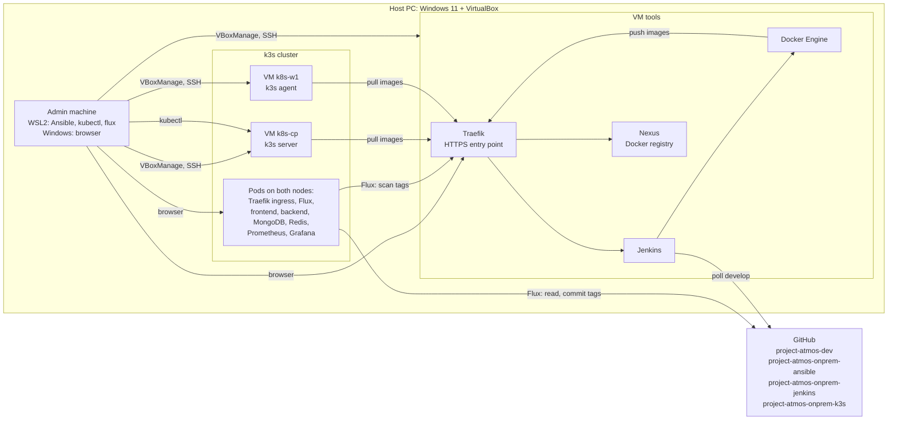
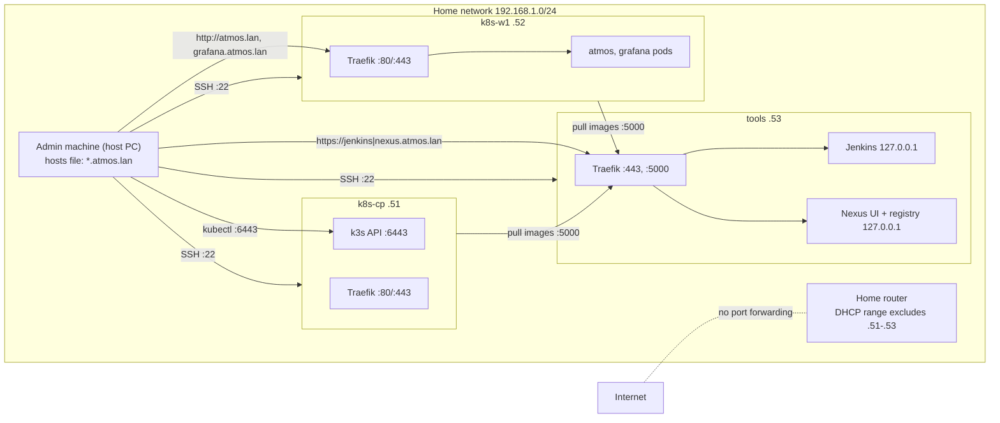
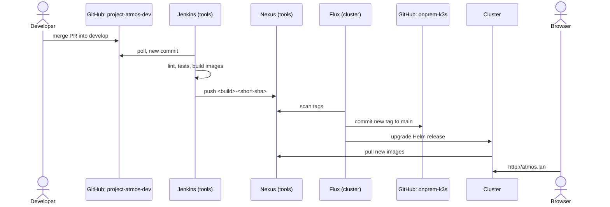

# Project Atmos: On-Premise Architecture

## 1. Overview

The Project Atmos application (React, FastAPI, MongoDB, Redis) runs in Kubernetes on three virtual machines on one personal PC. No cloud services are used. GitHub is the only external service: it stores the code and the platform configuration.

- **Ansible** creates the virtual machines and configures everything inside them.
- **Jenkins** checks and builds the application and stores the images in **Nexus**.
- **Flux** deploys the new images to the **k3s** cluster from Git.
- **Traefik** is the entry point: the ingress controller of the cluster and the reverse proxy for the tools.
- **Prometheus** and **Grafana** show the health of the application, the cluster and the servers.

The application code is the same as in the cloud version (`project-atmos-dev`). Only the platform around it is different.

## 2. Host computer and servers

**Host:** Windows 11 Pro, Intel i5-12100F (4 cores / 8 threads), 16 GB RAM, 500 GB disk. Hypervisor: VirtualBox.

**Admin machine:** the host itself. Ansible, `kubectl` and the Flux CLI run in WSL2 (Ubuntu); Ansible calls `VBoxManage.exe` for host tasks (`localhost` in the inventory). The browser runs in Windows. Installing VirtualBox, WSL2 and Ansible is the only manual step.

**Servers:** Ubuntu Server 24.04 LTS (image version and checksum pinned). Ansible creates them with `VBoxManage` (unattended install with the admin SSH key) and configures them. After the base configuration, each server gets a `clean` snapshot for a fast rebuild.

| Server | Role | Runs |
|---|---|---|
| `tools` | CI server, kept outside the cluster | Docker Engine; containers: Jenkins, Nexus, Traefik; node-exporter |
| `k8s-cp` | Kubernetes control plane | k3s server, node-exporter |
| `k8s-w1` | Kubernetes worker | k3s agent, node-exporter |

The cluster is a real two-node cluster: the scheduler uses both nodes for pods. `tools` is separate, so a broken cluster does not stop builds and Jenkins does not take RAM from the application.

Jenkins, Nexus and Traefik on `tools` run as Docker containers with a memory limit and the restart policy `unless-stopped`; Jenkins and Nexus also have a data volume. k3s and node-exporter run as systemd services. Everything starts by itself after a restart.

Jenkins builds the images with the Docker Engine of `tools` through the mounted Docker socket. It runs one build at a time (one executor), so a build fits into the RAM budget.

**Start and stop:**
- `vms.yml` creates the servers that do not exist and starts them in the order `tools`, `k8s-cp`, `k8s-w1`.
- `stop.yml` stops them safely in the order `k8s-w1`, `k8s-cp`, `tools`.
- When the servers are stopped, nothing runs on the host. Stop them before games, Windows updates or sleep.

**Rebuild:**
- **Whole platform:** restore the `clean` snapshots (or recreate the servers with `vms.yml`) and run `site.yml`. Then do the manual steps, because secrets are not stored in Git and Jenkins configuration as code is out of scope:
  1. In Jenkins, add the deploy key and the registry credentials and create the Pipeline job.
  2. Start one Jenkins build. Nexus is empty after a rebuild, so the application cannot start before the first images exist.
  3. Bootstrap Flux with a new short-lived token.
  4. Create the Kubernetes Secrets.

  Flux then installs the application and monitoring from `project-atmos-onprem-k3s`.
- **Only `k8s-w1`:** run `kubectl delete node k8s-w1` before the new server joins. Otherwise k3s rejects it, because the password of the old node is still stored in the cluster.
- **`k8s-cp`:** a new control plane is a new cluster. Rebuild both cluster servers and repeat the Flux bootstrap and the Secrets.
- Weather history (MongoDB) and images (Nexus) have no backup and are lost on a rebuild.

## 3. Resource budget

### Per server

| Server | vCPU | RAM | Disk |
|---|---:|---:|---:|
| `tools` | 3 | 5 GB | 80 GB |
| `k8s-cp` | 2 | 2.5 GB | 40 GB |
| `k8s-w1` | 2 | 4 GB | 60 GB |
| **Servers total** | **7** | **11.5 GB** | **180 GB** |
| Windows and WSL2 (WSL2 limited to 1 GB in `.wslconfig`) | — | 4.5 GB | — |
| Snapshots | — | — | up to 40 GB |

7 vCPU on 8 host threads is acceptable: the servers are idle most of the time, and only builds use a lot of CPU for a short time. Disk use is about 220 GB of 500 GB.

### Per component on `tools`

| Component | RAM (limit) | Disk |
|---|---:|---:|
| Ubuntu, node-exporter | 0.5 GB | 10 GB |
| Docker Engine | 0.2 GB | 20 GB (images, build cache) |
| Jenkins (JVM heap 1 GB) | 1.2 GB | 10 GB (jobs, workspaces) |
| Image builds (peak) | 0.9 GB | — |
| Nexus (JVM heap 1 GB) | 2 GB | 30 GB (images) |
| Traefik | 0.1 GB | — |
| **Total / free** | **4.9 GB / 0.1 GB** | **70 GB / 10 GB** |

### Per component in the cluster

| Layer | RAM |
|---|---:|
| Ubuntu, node-exporter (2 servers) | 0.8 GB |
| k3s server on `k8s-cp` | 0.9 GB |
| k3s agent on `k8s-w1` | 0.3 GB |
| **Left for pods** | **4.5 GB** |

| Pod (namespace) | RAM (limit) |
|---|---:|
| CoreDNS, metrics-server, local-path provisioner (`kube-system`) | 0.3 GB |
| Traefik ingress (`kube-system`) | 0.2 GB |
| Flux controllers (`flux-system`) | 0.7 GB |
| frontend (`atmos`) | 0.1 GB |
| backend (`atmos`) | 0.3 GB |
| MongoDB (`atmos`) | 0.6 GB |
| Redis (`atmos`) | 0.1 GB |
| Prometheus (`monitoring`) | 0.6 GB |
| Grafana (`monitoring`) | 0.25 GB |
| kube-state-metrics (`monitoring`) | 0.1 GB |
| **Total / free** | **3.25 GB / 1.25 GB** |

Monitoring uses about 1 GB. Every pod has a memory request, a memory limit and a CPU request; pods have no CPU limits. The scheduler places pods by their requests, and `k8s-cp` has only about 1.2 GB for pods, so the requests must be set.

MongoDB and Prometheus are pinned to `k8s-w1` with a `nodeSelector`. local-path keeps their data on the node where they start first, and the disk budget below plans these volumes on `k8s-w1`.

Disk: `k8s-cp` 40 GB (OS 10 GB, k3s and images 10 GB, free 20 GB); `k8s-w1` 60 GB (OS 10 GB, images 20 GB, volumes 10 GB: MongoDB 5 GB, Prometheus 5 GB; free 20 GB).

The numbers are planned values. Real use is compared with this budget in Grafana (US-06).

## 4. Network

- The home network is `192.168.1.0/24`. Each server has one bridged adapter, so it is a normal device in the home network.
- Fixed addresses (netplan), outside the router DHCP range. SSH only with keys, only from the admin machine.
- The host PC also needs a fixed address (DHCP reservation in the router): `ufw` allows SSH and the Kubernetes API only from this address. Traffic from WSL2 reaches the servers with the address of the host.
- No DNS server. Ansible writes the names to the hosts files:
  - Windows hosts file: all `*.atmos.lan` names (for the browser);
  - `/etc/hosts` on every server: `nexus.atmos.lan` (for Docker and k3s);
  - k3s `coredns-custom` ConfigMap: `nexus.atmos.lan` (for Flux in pods; pods do not read `/etc/hosts` of the node). It is placed by Ansible in `roles/k3s/` together with `registries.yaml`.
- A self-signed CA and a certificate for `*.atmos.lan` are created by Ansible. The name is set in the SAN field of the certificate: Docker, containerd and Flux do not accept a name only in the CN field. The CA is trusted on the admin machine, in Docker on `tools`, on the cluster nodes (`registries.yaml`) and in Flux.
- The home router forwards no ports. Nothing is reachable from the internet.

| Name | Address | Served by | Protocol |
|---|---|---|---|
| `atmos.lan` | 192.168.1.52 | Traefik in the cluster | HTTP |
| `grafana.atmos.lan` | 192.168.1.52 | Traefik in the cluster | HTTP |
| `jenkins.atmos.lan` | 192.168.1.53 | Traefik on `tools` → Jenkins | HTTPS |
| `nexus.atmos.lan` | 192.168.1.53 | Traefik on `tools` → Nexus web interface | HTTPS |
| `nexus.atmos.lan:5000` | 192.168.1.53 | Traefik on `tools` → Nexus Docker registry | HTTPS |

| Server | Address | Open ports (`ufw`) |
|---|---|---|
| `tools` | 192.168.1.53 | 22 (admin), 80/443 (home network), 5000 (`tools` and cluster nodes), 9100 (cluster nodes) |
| `k8s-cp` | 192.168.1.51 | 22 (admin), 6443 (admin, `k8s-w1`), 10250 and 8472/udp (cluster nodes), 80/443 (home network), 9100 (cluster nodes) |
| `k8s-w1` | 192.168.1.52 | 22 (admin), 10250 and 8472/udp (cluster nodes), 80/443 (home network), 9100 (cluster nodes) |

- On `k8s-cp` and `k8s-w1`, `ufw` also allows the k3s pod network `10.42.0.0/16` and service network `10.43.0.0/16`. Without these rules, pods cannot reach the API server or node-exporter on their own node (for example Flux, CoreDNS, Prometheus).
- Jenkins, the Nexus web interface and the Nexus Docker connector are published only on `127.0.0.1` of `tools`. Traefik runs in the host network of `tools`, so it reaches them there.
- Ports that Docker publishes in the normal way are not filtered by `ufw`: Docker adds its own `iptables` rules before the `ufw` rules. Because Traefik uses the host network, its ports 80, 443 and 5000 are real host ports, and the `ufw` rules above apply to them.
- The k3s load balancer (ServiceLB) publishes the cluster Traefik on ports 80/443 of both nodes. The names point to `k8s-w1`.
- In the cluster, NetworkPolicy allows MongoDB and Redis to accept traffic only from the backend.
- The addresses are examples. The real addresses are set in the Ansible inventory.

## 5. Tools

| Area | Tool | Where |
|---|---|---|
| Server creation | Ansible + `VBoxManage` | admin machine → VirtualBox |
| Server configuration | Ansible, versions pinned in `group_vars/` | admin machine → servers |
| Kubernetes | k3s (pinned version) | `k8s-cp`, `k8s-w1` |
| Ingress | Traefik bundled with k3s, memory limits in a `HelmChartConfig` | cluster |
| Reverse proxy | Traefik container in the host network, file configuration, self-signed certificate | `tools` |
| Storage | k3s `local-path` (data on the disk of the node that runs the pod) | cluster |
| CI | Jenkins container, pinned plugins (Pipeline, Git, Credentials, Docker Pipeline), one executor | `tools` |
| Image build | Docker Engine | `tools` |
| Image registry | Nexus Repository, Docker hosted repository, cleanup policy | `tools` |
| Packaging | Helm chart `charts/atmos/` | `project-atmos-onprem-k3s` |
| GitOps / CD | Flux with image automation | cluster |
| Firewall | `ufw` on every server; NetworkPolicy in the cluster | servers, cluster |
| Metrics | Prometheus (retention 3 days), kube-state-metrics | cluster |
| Server metrics | node-exporter (systemd) on all three servers | servers |
| Dashboards | Grafana | cluster |
| Logs | `kubectl logs` only, no log storage, to keep RAM free | cluster |

**Secrets:**

| Secret | Stored in |
|---|---|
| Nexus and Jenkins admin passwords, Nexus users, registry credentials | Ansible Vault in `project-atmos-onprem-ansible`; the vault password stays outside the repository |
| Read-only deploy key for `project-atmos-dev`, Nexus push user | Jenkins Credentials store (not in Git) |
| OpenWeather key, MongoDB password, Grafana admin password, Flux registry credentials | Kubernetes Secrets created by hand, never in Git |
| Flux deploy key (write access to `project-atmos-onprem-k3s` only) | Flux in the cluster and GitHub |
| GitHub token for the Flux bootstrap | used once, then revoked |

Nexus has separate users: Jenkins can push; the cluster and Flux can only pull.

The reasons for the main choices are recorded in the ADRs: [ADR-001 Platform (k3s)](ADR/001-platform-k3s.md), [ADR-002 CI/CD (Jenkins, Nexus, Flux)](ADR/002-cicd.md), [ADR-003 Ingress (Traefik)](ADR/003-ingress-traefik.md).

## 6. Delivery flow

**Developer → GitHub → Jenkins → Nexus → Flux → `project-atmos-onprem-k3s` → cluster → Traefik → browser**

| Step | Where | What happens |
|---|---|---|
| 1 | GitHub | A Pull Request is merged into `develop` of `project-atmos-dev` |
| 2 | Jenkins (`tools`) | SCM polling finds the new commit (GitHub webhooks cannot reach the home network) |
| 3 | Jenkins (`tools`) | The `Jenkinsfile` from `project-atmos-onprem-jenkins` runs lint and tests; a failed check stops the build |
| 4 | Jenkins (`tools`) | Docker builds the backend image and the frontend image (API address `/api`) |
| 5 | Nexus (`tools`) | Jenkins pushes the images with the tag `<build>-<short-sha>`, for example `42-a1b2c3d`, and removes the local images |
| 6 | Flux (cluster) | Flux scans Nexus; the image policy selects the highest build number |
| 7 | GitHub | Flux commits the new tag to `main` of `project-atmos-onprem-k3s` |
| 8 | Cluster | Flux upgrades the Helm release; the nodes pull the new images from Nexus; the pods are replaced |
| 9 | Browser | `http://atmos.lan`: Traefik routes `/api` to the backend and `/` to the frontend |

- Jenkins does CI. Flux does CD. Jenkins has no kubeconfig and no access to `project-atmos-onprem-k3s`.
- Every deployed version is a commit in `project-atmos-onprem-k3s`.
- The image policy is numerical: it reads the build number from the tag (`<build>-<short-sha>`) and selects the highest one.
- The image tags and the Flux image policy markers are in `spec.values` of the HelmRelease, not in `charts/atmos/values.yaml`. Flux applies a change inside the chart only when the chart version changes, so a new tag in the chart values would not start an upgrade.
- **Rollback:** suspend the image update automation (`flux suspend image update`), revert the tag commit in Git, and resume the automation after the fix.
- **Status:** `flux get helmreleases` and `flux get images all` show the deployed version and failures.
- The GitHub Actions workflow in `project-atmos-dev` is for the cloud and starts only by hand, so it does not run on the same commits.

## 7. Repositories

| Repository | Responsibility | Main content | User stories |
|---|---|---|---|
| `project-atmos-dev` | Application source, shared with the cloud version, and the on-premise documentation; nothing on-premise specific except the docs | application code, Dockerfiles, `docs/on-premise/` | US-01, US-07 |
| `project-atmos-onprem-ansible` | Everything that creates and configures the servers | `inventory/`, `group_vars/` (versions, Ansible Vault), `roles/` (`virtualbox_vm`, `common`, `docker`, `nexus`, `jenkins`, `traefik`, `k3s`), `vms.yml`, `site.yml`, `stop.yml` | US-02 |
| `project-atmos-onprem-jenkins` | CI: image build and tagging, publishing images to the Nexus registry | `Jenkinsfile` | US-03 |
| `project-atmos-onprem-k3s` | Everything that runs inside the cluster | `charts/atmos/` (application, Ingress, NetworkPolicy), Kubernetes manifests, `flux-system/`, image automation, `monitoring/` | US-04, US-05, US-06 |

The split follows one rule: a change to a server goes to `project-atmos-onprem-ansible`, a change to the build goes to `project-atmos-onprem-jenkins`, a change to what runs in the cluster goes to `project-atmos-onprem-k3s`. Note that k3s itself is installed by Ansible (`roles/k3s/` in `project-atmos-onprem-ansible`); `project-atmos-onprem-k3s` holds only the workloads of the cluster.

Each user story has its issue in the repository where most of its work happens (column **User stories**). Some stories also change `project-atmos-onprem-ansible`:

- US-03 adds the `docker`, `nexus`, `jenkins` and `traefik` roles;
- US-04 adds the `k3s` role (k3s install, `HelmChartConfig` for Traefik, `registries.yaml`);
- US-06 adds the firewall rule for port 9100 and the `grafana.atmos.lan` hosts entry.

The project board collects the issues from all four repositories.

The Jenkins job is "Pipeline script from SCM" pointing to `project-atmos-onprem-jenkins`. The `Jenkinsfile` checks out `project-atmos-dev` (branch `develop`) with a read-only deploy key.

The branching model of all repositories is described in [branching-model.md](branching-model.md). The risks are listed in [risks.md](risks.md).
